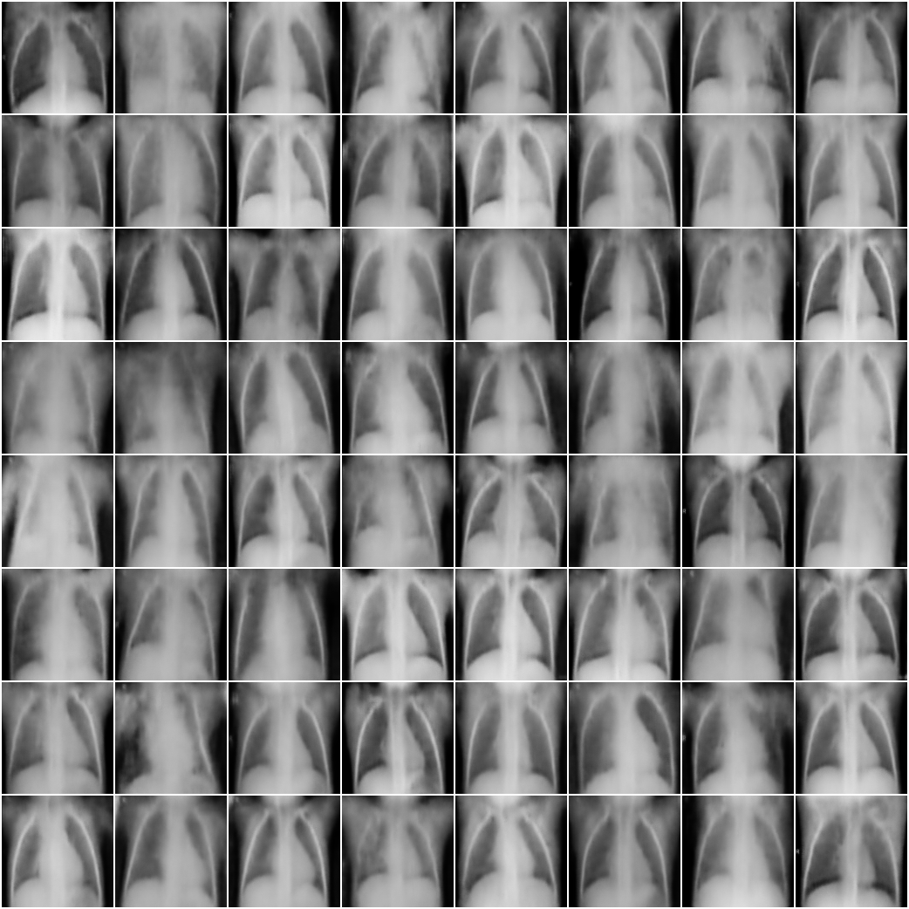
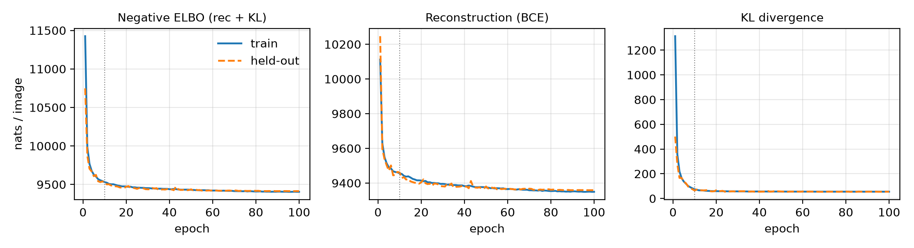

# VAE for Chest X-Ray Generation

Convolutional variational autoencoder trained on the
[Kaggle chest X-ray (pneumonia) dataset](https://www.kaggle.com/paultimothymooney/chest-xray-pneumonia)
to generate 128x128 chest X-rays. Generated images are evaluated with FID and Inception Score using
[pytorch-ignite](https://pytorch-ignite.ai/blog/gan-evaluation-with-fid-and-is/).

## Setup

```
pip install -r requirements.txt
```

Download the dataset from Kaggle and unzip it so that `chest_xray/` contains `train/`, `val/` and `test/`.

## Usage

```
python vae_cxr.py --data_root path/to/chest_xray
```

This trains for 100 epochs (about 3 minutes on an RTX 5060 Laptop GPU), then computes FID / IS.
Outputs are written to `runs/vae_cxr/`:

| File | Contents |
|---|---|
| `history.csv` | per-epoch train / held-out losses |
| `loss_curves.png`, `loss_curves.pdf` | loss curves |
| `samples_final.png` | 64 samples from the prior |
| `reconstructions.png` | held-out images (top) and reconstructions (bottom) |
| `metrics.json` | FID / IS |
| `vae.pt` | model weights (not tracked in git) |

## Results

| Image set (2,500 images) | FID | IS |
|---|---|---|
| VAE samples | 0.212 | 1.86 |
| VAE reconstructions | 0.231 | 2.05 |
| Real images (baseline) | 0.0015 | 2.20 |

FID is computed against 2,500 training images with torchvision's Inception-v3, so values are only
comparable to the real-image baseline, not to FIDs reported on natural images.




